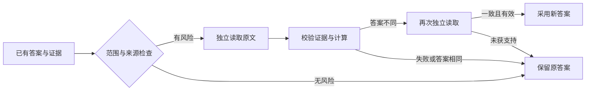

# Table Ledger

面向复杂表格的证据约束、范围检查与保守复核扩展。

把“读到了什么”“题目要求什么”“如何得到答案”分别记录，检查数组顺序、空白、完整表头和计算来源。出现风险时重新读取原文；改变已有答案前，要求另一条独立读取结果支持。

## 能力

- 明确列举目标的顺序与数量检查。
- 多级表头、分组行标题与合并标题继承检查。
- 区分空白、零、横杠及前导零编号。
- 逐答案元素绑定原文证据，检查完整范围清单。
- 受限精确计算、显式金额单位冲突检查及重复操作数防护。
- 保留原始响应、检查原因与恢复所需的缓存指纹。



## 安装与使用

本仓库发布原创扩展和完整的自建合成数据集，不包含基础运行环境、服务凭据或历史运行输出。扩展需要单独安装提供约定接口的后端；安装步骤及接口要求见 [INSTALL.md](INSTALL.md)。数据检查和导出可独立运行，无需后端。

```bash
python -m pip install .
export TABLELEDGER_BACKEND_ROOT=/path/to/compatible/backend
python -m tableledger check
python examples/check_scope.py
python -m unittest discover -s tests -v
```

检查命令和示例不发起网络调用。实际读取能力由调用方提供，模型选择、接口地址、凭据和预算留在调用方配置中。

## 自建数据集

完整数据位于 [benchmarks/](benchmarks/README.md)：**276 道中文题目、48 份原创合成文档**，包含 45 张 PNG 与 3 份双页 PDF。原始文档、题目、标准答案、逻辑源表、合并关系、文件摘要和生成脚本均已收录。

| 题型 | 标识 | 题数 | 占全部题目 |
|---|---|---:|---:|
| 内容提取 | `extract` | 144 | 52.17% |
| 内容推理与计算 | `thinking` | 96 | 34.78% |
| 局部结构恢复 | `structure` | 36 | 13.04% |
| 合计 | | **276** | **100%** |

百分比按题数计算，分项因四舍五入可能不等于 100%。

| 子集 | 文档 / 题目 | 覆盖内容 | 当前使用情况 |
|---|---:|---|---|
| [版式与数值](benchmarks/synthetic_v1/README.md) | 36 / 216 | 12 个模板族，合并表头、列换序、单位、负数、空白、弱边框、小图、旋转、脚注、跨页 | 用于开发、消融和回归；保留历史 144/72 题划分 |
| [部门与范围](benchmarks/chinese_diagnostics_v1/README.md) | 12 / 60 | 部门跨行合并、重复叶表头、顺序数组、空白/零/横杠、小计与合计排除 | 用于独立重读、范围与单位检查的回归诊断 |

两套数据都已用于本项目的迭代，当前按**公开回归集**使用。原 `holdout` 字段仅保留历史划分，不能据此把它们当作本项目新的未见测试集。它们来自程序生成，不能代表真实文档的完整分布。

克隆仓库后，在仓库根目录运行：

```bash
python benchmarks/manage.py verify
python benchmarks/manage.py stats
python benchmarks/manage.py export --output /tmp/table-ledger-inputs.jsonl
```

这三条命令只依赖 Python 标准库，不发起网络或模型调用。导出的 JSONL 只包含问题字段和文档路径；标准答案及逻辑源表留在核验侧。字段定义、历史划分、使用约束和重建方法见 [数据说明](benchmarks/README.md)。

## 边界

程序检查证据与答案是否一致，不能仅靠模型自报的坐标证明文字识别正确。明确范围的编译覆盖有限；复杂表达可能保留原答案。两次独立读取仍可能有相同错误，因此该扩展默认用于受控验证，不能将内部校验通过率当作真实准确率。

## 许可证

原创扩展、自建合成数据及生成脚本采用 **AGPL-3.0-only**。详见 [LICENSE](LICENSE)。网络服务中的修改版本也受该许可证相关源码提供条款约束；允许商业使用。基础组件和其他独立依赖不因本仓库的许可证而自动获得授权，见 [THIRD_PARTY_NOTICES.md](THIRD_PARTY_NOTICES.md)。
