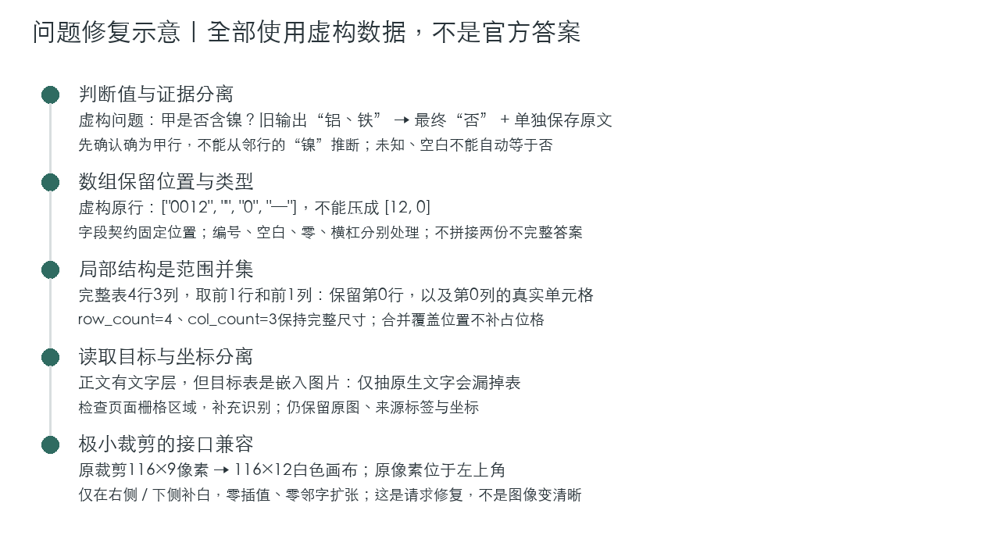
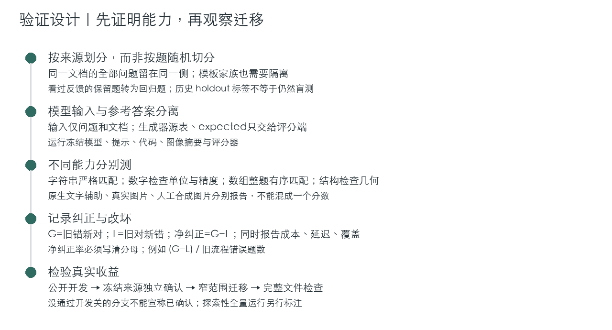

# 表格读取、证据与验证设计

本文是原创方法说明，描述本地实验体系的设计；不表示全部实验模块均已包含于当前安装包。包内能力与接口以仓库安装说明和模块清单为准。

## 演进与组合

系统从直接读取发展为输入契约、文档预处理、来源地址、类型化答案、受限计算、差异复核和文件校验。共享转录可以降低重复读取，却可能把一次误读传播到多个问题。新增模块需要单独验证，不能仅因存在源码就设为默认。

功能组合、答案继承和版本控制合并是不同动作。候选通过整题检查后才替换；失败时保留原答案。同一模型不同提示的一致不等于独立证据，也不保证来源正确。

## 可复现修复模式

判断任务将最终判断值与支持原文分开保存。数组保护顺序、重复、空位及前导零。局部结构保留完整逻辑尺寸，并只输出范围并集内的真实单元格。混合文档分别检查原生文字与图片区域。极小裁剪只补传输白边，不重采样、不扩到邻字；这类修复只解决接口限制，不会恢复原本不存在的细节。

图中内容均为虚构说明，不是外部文档的答案或新增评测标签。

## 验证集与评分

公开原创集含508题、112文档：提取336（66.14%）、推理96（18.90%）、结构76（14.96%）。按答案形状为数字324、数组108、结构76，没有独立字符串题，其中192题为行列数或表头层数。这是该数据集自身分布，不能代表所有真实文档。

同文档与同模板族尽量留在同一划分。历史保留标签须结合实际使用记录；看过反馈的数据后续作为回归。输入导出不包含expected或生成源表。真实视觉、合成视觉与文本辅助输入分开报告。

数字服从单位与精度；字符串保护标点及编号；数组按整题有序判分；结构同时检查文本、尺寸、坐标和跨度。记录纠正G、改坏L、净变化G−L，以及覆盖、拒绝、延迟、费用。净纠正率必须明确分母，不与候选通过率混用。不能把缓存速度冒充冷启动速度。

## 仍然存在的限制

文字目录不能自动证明空白格、完整集合和行列关系。复杂证据协议可能拒绝本来能答对的简单题；回退后的准确率不等于新读取器的准确率。不同模型或提示可能共同选错来源。合成生成器与参考答案也可能共享错误，仍需独立校核及新来源验证。

## 许可和公开边界

原创代码及原创数据遵循仓库AGPL-3.0-only许可。外部数据、字体与上游代码各自受其许可约束；本文不重新授权它们。公开包不包含服务凭据、私有文档、外部原件或历史模型响应。新增实现是否进入安装包，须以实际提交与测试清单为准。
